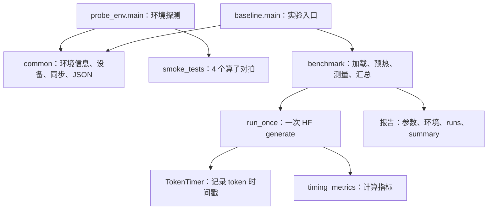
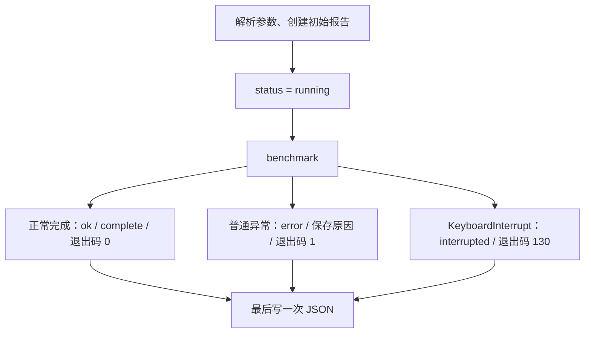

# M0 代码设计与原理：逐模块读懂环境探测和推理基线

本文对应当前仓库中的 M0 实现。运行命令、进入与退出环境的方法见[运行与学习指南](M0环境与基线.md)；这里解释代码为什么这样设计，以及数据如何经过每一部分。

建议打开文档和源文件对照阅读：先读第 1～3 节建立整体认识，再沿 `main → benchmark → run_once → TokenTimer → timing_metrics` 跟踪一次生成，最后读测试。

## 1. M0 在整个项目中负责什么

M0 的交付物是**环境诊断工具和可追溯的单请求实验基线**。它先验证开发板能做基本计算，再调用 Hugging Face（下文简称 HF）已有的 Qwen3 实现测量生成过程。

后续手写模型前向、分页 KV 和连续批处理时，需要回答“输出是否正确”“时间花在哪里”“新实现相对什么变快”。M0 为这些问题提供起点。

| 当前负责的内容 | 当前实现位置 |
| --- | --- |
| 记录软件、硬件、运行代码信息 | `bench/common.py`、`bench/probe_env.py` |
| 小张量 NPU 结果与 CPU 参考对比 | `probe_env.smoke_tests()` |
| 加载模型、准备输入、设置生成参数 | `baseline.benchmark()` |
| 观察每个输出 token 的时间 | `baseline.TokenTimer` |
| 计算指标、保存每轮原始结果 | `timing_metrics()`、`benchmark()` |
| 验证计数、计时与生成行为 | `tests/test_baseline.py` |

**M0 尚未手写 Qwen3 的层计算，也没有自研分页缓存、调度器或 HTTP 服务。** `mini_llm_ascend/` 中的目录仍是后续实现的预留位置。

## 2. 文件分工和调用关系

| 文件 | 职责 | 为什么单独放这里 |
| --- | --- | --- |
| [bench/__init__.py](../bench/__init__.py) | 标识 `bench` 包，只有模块说明 | 支持从项目根目录使用 `python -m bench...` |
| [bench/common.py](../bench/common.py) | 设备、同步、环境信息、报告写入 | 两个命令入口共享这些能力 |
| [bench/probe_env.py](../bench/probe_env.py) | 小算子探测 | 不用先加载 0.6B 模型就能检查基本链路 |
| [bench/baseline.py](../bench/baseline.py) | 完整单请求实验 | 把模型加载、计时和统计集中在一个容易顺序阅读的文件里 |
| [tests/test_baseline.py](../tests/test_baseline.py) | 计时单测、小模型集成测试 | 不下载大模型也能验证关键行为 |
| [requirements-m0.txt](../requirements-m0.txt) | 固定关键依赖版本 | 保留板载 torch/CANN，减少额外兼容性变量 |



这里以普通函数和字典为主。只有需要响应 HF 回调的 `TokenTimer` 使用类，避免在学习阶段引入多层继承和复杂注册机制。

### 命令是如何进入 Python 代码的

运行 `python -m bench.baseline` 时，Python 将该模块作为程序入口执行。文件末尾的：

```python
if __name__ == "__main__":
    raise SystemExit(main())
```

把 `main()` 返回的整数交给终端作为退出码。测试文件导入 `baseline` 时，模块名不是 `__main__`，因此不会意外启动完整基准。

## 3. 阅读代码前需要理解的推理过程

### 3.1 从文字到下一 token

Tokenizer 将文字编码成整数 token IDs；一个 token 不一定等于一个汉字或一个单词。聊天模板还会加入角色和回答起始标记，所以代码统计的是模板处理后的输入长度。

模型将输入 ID 转为向量，经过 Transformer 层，最终得到词表中各 token 的分数，即 logits。贪心解码选择当前允许候选中分数最高的 token，再将它用于下一步生成。遇到 EOS（结束标记）或达到输出预算后结束。

### 3.2 Prefill、Decode 和 KV Cache

第一次前向处理整个 prompt，通常称为 Prefill。每层计算出的 Key、Value 保存到 KV Cache，最后位置的 logits 用来选择第一个输出 token。

之后的 Decode 每次处理新输入的 token，读取此前的 K/V，并补入本轮 K/V。缓存减少了历史 token 的重复计算，但历史 K/V 仍需参与注意力计算。

用示意 IDs 表示：

```text
prompt = [101, 102, 103]         # 这里只是示意，不是真实 Qwen 编码
Prefill(prompt)  → 选择 201
Decode(201, KV) → 选择 202
Decode(202, KV) → 选择 203
```

生成出的 token 在下一次前向被输入模型时，才产生它自己的 K/V。因此普通自回归生成结束时，最后一个输出 token 可能还没有对应的已计算 KV。

在本项目中，这个循环和缓存维护由 HF 完成；我们通过 `use_cache=True` 启用缓存。每次 `run_once()` 都发起独立的生成调用，没有传入上一轮的缓存，因此**多轮相同 prompt 的预热不是 Prefix Caching**。

### 3.3 关键张量的逻辑形状

设批大小为 `B`，prompt 长度为 `S`，实际输出长度为 `N`。本基线固定 `B=1`。

| 数据 | 逻辑形状 | 说明 |
| --- | --- | --- |
| `input_ids` | `[1, S]` | 整数 token IDs |
| `attention_mask` | `[1, S]` | 标记有效输入，随后由 HF 配合生成过程维护 |
| 隐状态 | `[1, S, 1024]` | Qwen3-0.6B 的 hidden size 为 1024 |
| 最后位置的 logits | `[1, 1, 151936]` | 本路径只保留最后位置的词表投影结果 |
| 单层单份 K 或 V | `[1, 8, 已缓存长度, 128]` | 逻辑上的 KV head、序列长度和 head dimension |
| `generate()` 返回的 IDs | `[1, S + N]` | 包含原始 prompt 和新增输出 |

Qwen3-0.6B 配置包含 28 层、16 个 Q head、8 个 KV head，head dimension 为 128，Q 投影宽度因此为 `16 × 128 = 2048`，不能简单用 `1024 / 16` 推导 head dimension。[官方模型配置](https://huggingface.co/Qwen/Qwen3-0.6B/blob/main/config.json)

按 FP16 计算，每个缓存 token 的 K/V 数据量为：

```text
2（K 和 V）× 28（层）× 8（KV heads）× 128（每头维度）× 2（字节）
= 114688 字节 = 112 KiB
```

这是逻辑数据量推算，不包含分配器、临时张量和设备存储格式开销。M0 使用 HF 的缓存，不使用配置草案中的 8 GiB 自研分页池。

## 4. common.py：让实验可诊断、可追溯

### 4.1 为什么顶层只导入标准库

如果文件一开始就导入 torch，torch 安装损坏时可能连环境报告也无法创建。这里把 `import torch` 放到 `open_device()` 内；`environment_info()` 使用包元数据查询版本，不需要先加载每个库。

这样也便于计时单测导入模块：只测试公式时，不必初始化 NPU。

### 4.2 command_result(command, timeout=15)

输入是命令参数列表，例如 `['npu-smi', 'info']`。它用 `subprocess.run()` 收集退出码、标准输出和标准错误，不通过 shell 拼接执行。

- 命令执行完成：返回 `returncode`、`stdout`、`stderr`，非零退出码也保留。
- 命令不存在或超时：返回 `error`，不把整份诊断中断掉。
- `errors='replace'` 让异常编码的工具输出仍能被收集。

这里的 15 秒超时只约束外部诊断命令，**不约束 torch 初始化、模型加载或推理时间**。

### 4.3 environment_info()

返回一个字典，主要回答三类问题：

| 信息 | 对排查问题的价值 |
| --- | --- |
| Python 版本、解释器路径、系统与架构 | 确认是否误用了另一个 Python 或平台 |
| torch、torch_npu、Transformers 等包版本 | 固定讨论的软件组合；缺失包记为 `None` |
| Git HEAD、工作区状态、`bench/*.py` 的 SHA-256 | 区分“某个提交”和“提交后又改过的代码” |

`Path(__file__).resolve().parents[1]` 从源文件位置定位项目根目录，比依赖终端当前目录更可靠。UTC 时间用于记录实验时间，不参与耗时计算。

`.deployed_commit` 是兼容早期部署方式的可选记录。现在板端是普通 Git 仓库，可直接记录 HEAD。源码哈希只覆盖 `bench` 下的 Python 文件，不能代替整个依赖环境或模型权重校验。

### 4.4 open_device(name, dtype_name)

返回 `(torch, device, dtype)`，让调用者使用同一套明确的设备和精度设置。

| 分支 | 行为 |
| --- | --- |
| `npu` | 导入 torch_npu、检查可用性、选择 `npu:0` |
| `cpu` | 选择 CPU，本函数不主动导入 torch_npu |
| 未指定 dtype | NPU 默认 FP16，CPU 默认 FP32 |
| 显式指定 dtype | 将字符串转换为 `torch.float16` 等对象 |

请求 NPU 失败时抛出异常，不由脚本改成 CPU。但是，**torch_npu 仍可能将个别不支持的算子回退到 CPU**。选择 NPU 设备和“所有算子都在 NPU 上执行”是两个不同的保证。

### 4.5 synchronize(torch, device)

NPU 计算通常异步提交：Python 调用返回时，设备不一定算完。如果直接测调用前后的 Python 时间，可能只测到提交任务的耗时。

```text
设备同步 → 开始计时 → 提交并执行计算 → 设备同步 → 结束计时
```

开始前同步，避免把前一段尚未完成的任务计入本段；结束后同步，保证本段任务确实完成。该函数在 NPU 分支调用 `torch.npu.synchronize()`，CPU 分支不额外操作。

### 4.6 write_report(path, report)

自动创建父目录，把字典写成 UTF-8 JSON：`ensure_ascii=False` 保留中文，`indent=2` 便于阅读，`allow_nan=False` 禁止把 NaN/Infinity 当成正常 JSON 数字写出。

它覆盖同名文件，并非原子替换。因此另一终端恰好在写入时读取，可能看到不完整 JSON；硬断电也可能留下不完整文件。当前实现提供阶段诊断，但不是事务式日志系统。

## 5. probe_env.py：先用小输入验证基础计算

### 5.1 main() 的顺序

解析 `--device`、`--dtype`、`--output` → 收集环境信息和系统工具输出 → 打开设备 → 调用 `smoke_tests()` → 汇总 `ok` → 写报告并返回退出码。

`ok=True` 表示设备初始化和四个算子检查通过；它**没有把 npu-smi Health、所有依赖兼容性或完整模型正确性都作为通过条件**。这些诊断字段要另外阅读。

### 5.2 smoke_tests() 的输入与参考

先固定随机种子，生成 `x_cpu:[16,32]` 和 `w_cpu:[32,24]`。随后有一段值得理解的精度处理：

```python
x_cpu = x_cpu.to(dtype).float()
w_cpu = w_cpu.to(dtype).float()
```

例如目标为 FP16，先将随机值舍入到 FP16 可表示的精度，再升回 FP32 计算 CPU 参考。这样设备和参考使用相同的已舍入输入，比较更集中于计算差异；升回 FP32 不会恢复之前被舍掉的精度。

之后才把输入传到目标设备。四组操作及目的为：

| 检查 | 输入/输出逻辑形状 | 与后续引擎的关系 |
| --- | --- | --- |
| `matmul` | `[16,32] @ [32,24] → [16,24]` | 线性投影的基本计算 |
| `index_select` | 选择第 0、3、7、15 行，输出 `[4,32]` | 后续 KV gather 的基础能力 |
| `softmax` | 沿最后一维归一化，输出 `[16,32]` | 注意力中的概率归一化 |
| `argmax` | 每行取最大值索引，输出 `[16]` | 贪心 token 选择的基础能力 |

`cases` 中保存的是“待调用函数、CPU 参考结果”的二元组。`lambda` 让同一操作可以反复调用，而不在创建字典时就提前执行完设备计算。

### 5.3 小算子如何计时和判定

每个算子先调用 2 次预热，再同步；计时区间内调用 5 次，再同步，最后除以 5 得到平均毫秒数。结果回传 CPU、类型转换和误差计算发生在计时区间之外。只对这 5 次中的最后一次输出做数值比较。

判定使用 `torch.allclose`，逐元素允许的误差为：

```text
abs(actual - reference) <= atol + rtol * abs(reference)
```

当前 BF16 的 `atol/rtol` 都为 0.05，其他 dtype 为 0.01。另记 `finite` 和最大绝对误差；非有限输出的最大误差记为 `None`，避免写出非法 JSON 数字。

这是小规模兼容性检查，阈值不是完整 Qwen3 的精度验收标准。当前 argmax 也沿用通用比较逻辑；若扩展到大词表，索引正确性应优先用严格相等验证，不能仅沿用相对误差阈值。

单个算子异常只将该项记录为失败，其他项继续检查。最终所有算子的 `ok` 都为真，探测才通过。小形状、少次数测量不能用于宣称峰值算力或有效带宽。

## 6. baseline.py：完整生成流程是怎样组织的

### 6.1 parse_args()：把命令变成实验参数

`argparse` 把命令行转换为 `args` 对象。`--model` 必填；默认设备为 NPU，默认最多生成 32 token、预热 1 轮、测量 3 轮。学习指南显式使用更短的长度，以减少第一次编译的等待。

`--max-new-tokens` 和 `--runs` 必须大于零，`--warmup` 允许为零。设备和 dtype 使用固定选项，避免拼写错误悄悄变成另一种配置。`--model-revision` 只是写入报告的来源说明，不会自动下载或验证权重。

### 6.2 main()：管理实验状态和退出码

入口先建立报告，记录 `args`、环境、batch 大小和计时口径，然后调用 `benchmark(args, report)`。`report` 是可变字典，内部函数直接补充字段，避免长流程之间返回一大串独立变量。



这里捕获的是调用 `benchmark()` 期间的 Python 异常。参数解析错误通常由 argparse 以退出码 2 结束；初始环境收集、首次报告写入和最终写入不都在这个保护范围内。硬退出、进程崩溃、磁盘写入失败也不能保证保存报告。

### 6.3 benchmark() 第一步：验证模型来源

先把 `args.model` 转为绝对路径，再检查 `config.json` 存在，并确认 `model_type == 'qwen3'`。这是模型家族检查，不代表代码已经限制参数量必须为 0.6B。

然后打开设备、导入 HF 类、设置随机种子，记录实际 device、dtype 和模型清单。`model_manifest()` 只遍历模型目录的直接子文件：

- `.json`、`.safetensors`、`.txt` 文件记录大小。
- JSON 文件额外计算 SHA-256，包括模型配置和 tokenizer 的 JSON。
- 不对大型权重计算哈希，报告中明确标为未计算。

这能帮助识别配置变更，但两个权重文件大小相同不能证明内容相同。归档实验中的权重校验和是另行计算并核对的。

### 6.4 第二步：离线加载 tokenizer 和模型

核心调用是 `AutoTokenizer.from_pretrained()` 与 `AutoModelForCausalLM.from_pretrained()`：

| 参数/操作 | 当前设计意图 |
| --- | --- |
| `local_files_only=True` | 只使用给定本地目录，不让运行时下载影响实验 |
| `trust_remote_code=False` | 不执行模型仓库自带的自定义 Python 实现 |
| `use_safetensors=True` | 使用 safetensors 权重 |
| `torch_dtype=dtype` | 按本次实验指定精度加载；不会改写原始权重文件 |
| `attn_implementation='eager'` | 选用 HF 的标准 attention 路径，先减少专用 attention 后端的兼容性变量 |
| `.to(device)` | 明确把整个模型放到选择的设备 |
| `.eval()` | 切换模块的推理行为，例如关闭训练态 dropout |

不使用 `device_map='auto'`，避免自动分配/卸载模型使实验设备边界难以理解。选择 eager 也不意味着底层 torch_npu 完全不做算子优化。

`load_s` 从 tokenizer 加载前开始，到模型搬到设备并完成同步后结束；之前的参数检查、模块导入和设备初始化不包含在这个字段里。

### 6.5 第三步：准备聊天输入

`apply_chat_template()` 将一条 user 消息整理成模型需要的聊天格式。`add_generation_prompt=True` 加入回答起始标记，`enable_thinking=False` 明确使用非思考模式。

随后 tokenizer 使用 `add_special_tokens=False`，避免在聊天模板之外再额外添加一套特殊 token。`return_tensors='pt'` 得到 PyTorch 张量，再整体搬到设备。

代码记录 `rendered_prompt`、真实 `input_ids` 和 `prompt_tokens`，并检查：

```text
prompt_tokens + max_new_tokens <= config['max_position_embeddings']
```

这只检查模型声明的位置上限，不能保证当前内存能容纳这么长的输入。

### 6.6 第四步：建立独立的生成配置

`GenerationConfig` 中几个关键选项：

| 选项 | 作用 |
| --- | --- |
| `do_sample=False`、`num_beams=1` | 单路径贪心生成，降低采样随机性对对比的影响 |
| `use_cache=True` | 让 HF 在一次生成中复用历史 K/V |
| `max_new_tokens=N` | 约束新增输出的最大长度，不包含 prompt |
| `min_new_tokens=N`（固定长度模式） | 在输出预算耗尽前抑制提前 EOS |
| `eos_token_id` | 沿用模型的结束标记配置，可能有多个结束标记 |
| `pad_token_id` | 优先使用 tokenizer 的 padding ID，缺失时采用其 EOS ID |

固定长度模式会改变 EOS 的选择条件，因此它服务于统一负载，不保证与自然结束的对话输出完全相同。每轮结束后还会检查实际长度是否符合固定预算。

`run_once()` 显式传 `use_model_defaults=False`，防止 HF 将模型默认的采样参数补回实验配置。单测故意给小模型设置采样默认值，检查本基线仍走贪心。

固定种子和贪心便于复现，但不承诺跨硬件、跨精度或非确定性算子的结果逐位一致。

### 6.7 第五步：预热、测量和汇总

先用同一输入和生成配置调用 `run_once()` 预热，丢弃其性能结果。目的是让本进程的初始化、编译、内存分配等成本尽量提前发生，而不是提前缓存答案。

随后尝试重置 NPU 峰值内存计数，建立空的 `runs` 列表。每个测量样本按以下顺序执行：

```text
写入 measuring_run_i 阶段
→ run_once()
→ 固定长度检查
→ 文本解码和内存查询
→ 追加到 runs
→ 保存报告并打印本轮摘要
```

文本解码、查询内存、写 JSON 和打印摘要都位于 `run_once()` 的计时区间之外。报告保留逐轮数据，再计算 mean 和 median，便于回看波动，不只留下一个平均数。

其中吞吐的 mean 是“各轮 token/s 的算术平均”，不是把所有输出 token 除以整个程序运行时间，也不是并发服务吞吐。若某项在所有样本中都为 `None`，例如每轮只输出一个 token 的 TPOT，汇总也保留 `None`。

`identical_output_ids` 比较各轮实际 ID 序列，而不是只比较解码后的字符串。它表示重复运行是否一致，不证明答案正确或 NPU 与 CPU 一致。

## 7. run_once() 与 TokenTimer：如何观察生成

### 7.1 run_once() 的完整职责

1. 为本轮新建 `TokenTimer`，避免混入上一轮的时间戳。
2. 同步设备，记录开始时间 `start`。
3. 在 `torch.inference_mode()` 中执行 HF `generate()`。
4. 再同步设备，记录结束时间 `end`。
5. 从返回 IDs 中去掉 prompt，得到新增输出。
6. 检查输出长度等于回调观测数量，再计算指标。

`.eval()` 和 `inference_mode()` 职责不同：前者切换模块的训练/推理行为，后者减少自动求导等运行时开销；仅调用 `.eval()` 不等于关闭梯度记录。

调用中的 `**inputs` 是 Python 字典解包，相当于将 `input_ids=...`、`attention_mask=...` 等参数按名称传进去。截取输出后的 `detach().cpu().tolist()` 则将张量转换成可保存到 JSON 的普通整数列表；这部分发生在记录 `end` 之后。

若 prompt 长度是 3，返回结果是 `[101,102,103,201,202]`，那么：

```python
generated = output[0, inputs["input_ids"].shape[1]:]
# 得到 [201, 202]；实际输出长度为 2
```

不能用配置的 `max_new_tokens` 代替实际长度，因为 EOS 可能提前终止生成。

### 7.2 logits_to_keep=1 为什么不会丢掉生成需要的结果

自回归选择下一 token 只需要当前最后位置的词表分数。`logits_to_keep=1` 让 Qwen3 只对最后位置做 LM head 投影，减少大词表输出开销；它不是只计算一个词表候选，也不是只处理一个 prompt token。[HF 4.51.3 Qwen3 实现](https://github.com/huggingface/transformers/blob/v4.51.3/src/transformers/models/qwen3/modeling_qwen3.py)

这个选择必须在未来的对照组中保持一致，否则“优化收益”可能只是基线多做了不必要的词表投影。

### 7.3 TokenTimer 为什么要跳过第一次 put()

当前使用的 HF 4.51.3 会先把完整 prompt 交给 streamer，后续再逐 token 回调；交给回调的 token 已转到 CPU。该行为可在[对应版本的生成源码](https://github.com/huggingface/transformers/blob/v4.51.3/src/transformers/generation/utils.py)中核对。

所以 `TokenTimer` 初始设置 `skip_prompt=True`：第一次 `put()` 只清除该标志；后续确认 `value.numel()==1`，再用 `time.perf_counter()` 记录时刻。

这里不调用 tokenizer，也不打印 token。token 和可见文字并非一一对应，打印还会引入终端 I/O 开销。`end()` 留空，因为本类没有需要刷新或拼接的文本缓冲。

它不继承特定 streamer 基类，而是提供 HF 所需的 `put()` 和 `end()` 接口。回调语义与依赖版本有关，升级 Transformers 时应重跑集成测试。

### 7.4 这里到底测到了什么

时间戳表示主机观察到生成 token 的时刻，包含它传回 CPU 的成本。开始/结束同步则界定整个生成调用，二者用途不同。

脚本没有在每次回调中额外调用全设备同步；当前回调前的 CPU token 搬运已经提供了 host 观测点。streamer 和传输本身仍有开销，因此这套结果不能直接当成纯 kernel 耗时，也不应与无回调的基准混用而不说明口径。

## 8. timing_metrics()：指标公式和一个手算例子

设 `s` 是生成开始时刻，`e` 是调用结束且设备同步后的时刻，`t1...tN` 是 N 个输出 token 的观测时刻。内部时间单位为秒。

| 指标 | 当前实现的公式 |
| --- | --- |
| `generate_s` | `e - s` |
| `ttft_ms` | `(t1 - s) × 1000` |
| `itl_ms[i]` | `(t(i+1) - ti) × 1000` |
| `tpot_ms` | ITL 的算术平均，即 `(tN - t1) × 1000 / (N-1)` |
| `output_tokens_per_s` | `N / (e - s)` |
| `finalization_ms` | `(e - tN) × 1000` |

函数先拒绝“没有输出 token”“时间倒退”“总时长不大于零”等输入。允许单个间隔为零；只有一个输出 token 时没有 Decode 间隔，返回 `None`，写入 JSON 后是 `null`。

使用单测中的示意时间，注意这不是实测性能：

```text
start=10s       token1=12s  token2=12.5s  token3=13s       end=15s
     |--------------|-----------|------------|---------------|
        等待首 token        后续 token 生成          结束整理
```

得到：TTFT=2000 ms；ITL=[500,500] ms；TPOT=500 ms；生成总时长=5 s；吞吐=3/5=0.6 token/s；结束整理=2000 ms。

如果直接用 `(总耗时 - TTFT)/(N-1)`，这个例子会得到 1500 ms，错误地把结束整理算进了 Decode。当前函数用真实 token 时间戳把二者分开。

TTFT 中包含 HF 生成准备、Prefill、首 token 选择和主机观测开销，不能把它直接等同于纯 Prefill kernel 时间。一般也不能把 `1000/TPOT` 当成整次请求吞吐，因为后者还包含首 token 和结束整理。

## 9. 报告、内存和失败处理

### 9.1 报告结构

```text
report
├── status / stage             本次执行是否完成、停在哪个阶段
├── args                       原始命令参数
├── environment                软件版本、代码版本、源码哈希
├── actual_device / dtype      实际选择的设备和精度
├── model_manifest / model_config
├── rendered_prompt / input_ids / prompt_tokens
├── generation_config / use_model_defaults
├── load_s
├── runs[]                     每轮耗时、输出 IDs、文本、内存
└── summary                    mean、median、样本数、重复输出一致性
```

失败或中断时可能没有 `summary`，后续阶段字段也可能不存在。分析程序应先看 `status`，而不是读到一个数就当成完整实验。阶段写入只发生在检查点，不是每秒更新的进度条。

`schema_version=1` 表示本项目报告格式的版本，和模型版本、Transformers 版本不是同一个概念；以后修改报告结构时，可据此区分解析方式。

`report['warnings']` 是预先写入的口径说明，**不会自动捕获所有框架 stderr 警告**。归档实验中的原始运行日志是额外保存的，分析 CPU fallback 等问题时需要一起看。

### 9.2 memory_snapshot() 的三个字段

| 字段 | 含义 |
| --- | --- |
| `memory_allocated_bytes` | 查询时框架分配器统计的当前已分配设备内存 |
| `memory_reserved_bytes` | 框架为复用而保留的设备内存，可能大于当前活跃分配 |
| `max_memory_allocated_bytes` | 峰值 allocated 计数 |

重置峰值只在预热后尝试一次，不在每个样本前重置，所以各轮记录的峰值是测量阶段截至该轮的高水位。重置失败会记入 `memory_reset_error`，不能再假设峰值排除了预热。

内存快照发生在生成调用返回后，不能当成解码中间时刻的 KV 占用。CPU 模式只写说明，不伪造 NPU 内存；接口失败也记录错误。这里没有统计完整系统 RSS、驱动全部内存或加载过程峰值。

## 10. tests/test_baseline.py：7 项测试分别防什么

### 10.1 计时单测使用可控输入

`FakeToken` 只实现 `numel()`，因为被测试的 timer 不需要完整张量。`patch()` 把时钟或函数临时替换为指定行为，离开 `with` 块后恢复，不修改正式程序。

| 测试函数 | 人为构造的场景 | 防止的错误 |
| --- | --- | --- |
| `test_prompt_is_not_first_generated_token` | 第一次回调是 prompt，后两次时刻为 12 和 12.5 | 将 prompt 误计为输出，导致首 token 延迟偏小 |
| `test_finalization_does_not_inflate_decode_interval` | 最后 token 后还有 2 秒整理 | 将结束整理错误计入 TPOT |
| `test_one_token_has_no_decode_interval` | 只输出一个 token | 除以零或把不存在的 TPOT 写成 0 |
| `test_no_tokens_and_bad_clock_are_errors` | 空时间列表、时间倒退 | 对无效输入输出看似正常的性能数字 |
| `test_interrupt_saves_diagnostic_report` | 让 `benchmark()` 抛出 KeyboardInterrupt | 中断后错误地写成成功，或丢失中断状态 |

中断测试在临时目录写报告，检查退出码 130、`status='interrupted'` 和没有成功汇总。它验证 Python 层处理逻辑，不模拟设备原生调用迟迟不返回或进程被强制终止。

### 10.2 集成测试使用真实的小 Qwen3

`TinyQwenIntegrationTests.setUpClass()` 只创建一次随机小模型：1 层、hidden size 32、4 个 Q head、2 个 KV head、词表 32。输入为 `[1,4,5]`，不需要下载权重。

`run_config()` 提供测试共用的生成配置。小模型的默认配置故意打开采样，用来模拟真实 checkpoint 的默认设置。

- `test_streamer_matches_direct_generate_and_fixed_length`：固定输出 4 个 token；临时让 `torch.multinomial` 一被调用就报错，确认没有意外启用采样；再比较带计时回调与直接 `generate()` 的输出 IDs，检查观测没有改变结果，并确认恰好有 3 个 token 间隔。
- `test_early_eos_counts_actual_tokens`：先求模型下一步的贪心预测，把这个 token 配成 EOS；即使预算为 4，也应实际只输出 1 个，并且 TPOT 为 `None`。

这两个测试通过，说明包装器在这些场景下与 HF 行为一致。它们运行于 CPU，不是完整 0.6B 模型的 NPU 数值对拍，也不验证语言回答质量。

## 11. 依赖、配置与部署脚本在 M0 中的角色

| 部分 | 当前作用与边界 |
| --- | --- |
| `requirements-m0.txt` | 固定 Transformers 4.51.3、hub 0.30.2、tokenizers 0.21.4、safetensors 0.7.0、einops 0.8.1；完整传递依赖仍以实际环境记录为准 |
| 板载 torch / torch_npu / CANN | 由已有配套环境提供，没有写进安装文件让 pip 随意替换 |
| `.venv` | 通过 `--system-site-packages` 复用板载框架；它不是完全独立的 Python 发行版 |
| `configs/qwen3-0.6b.yaml` | 后续引擎的规划参数；当前 `baseline.py` 和 `probe_env.py` 都不读取它 |
| `scripts/board_init.sh` | 建立标准 Git 项目目录、模型/结果目录及环境；使用 `updateInstead` 接收部署，不自动安装全部依赖 |
| `scripts/deploy.ps1` | 默认推送已提交的 main 到 board；可选 rsync 同步当前源码；`-Push` 还会推送 origin |
| `.gitignore` | 排除模型、环境、运行产物和本地迁移备份；不影响已归档到 docs 下的实验材料 |

hub 的固定版本来自旧 aarch64 环境的安装验证，einops 用于满足 HF 检测到 NPU 后引入的适配模块依赖。即使指定 eager，模块导入阶段仍可能需要它。

部署与模型推理是不同操作：推送源码不会自动启动基准或服务。`board_init.sh` 对已有 `.venv` 不会重建，移动环境则需要另外修复绝对路径；日常使用按[目录与部署说明](目录与部署.md)操作。

## 12. 当前能得出什么结论，下一阶段接着做什么

当前已验证基础 NPU 算子、基准包装器的关键行为，以及短请求在目标板上的执行链路。原始记录见[实测报告](experiments/m0-310b4/README.md)。

解释结果时保留以下边界：

- 极小张量检查不代表所有模型算子正确或所有 shape 都受支持。
- 日志中的 CPU 回退、storage_offset 数值警告和设备健康告警没有因为“生成成功”而自动消失。
- 3 个短样本只适合作为起始锚点，无法支持稳定 P99、长上下文或高并发结论。
- 单次预热不保证覆盖所有新 shape、dtype 和后端路径的编译成本。
- 原始参数、真实 token 数和计时口径必须一致，才适合讨论后续优化收益。

M1 将增加手写前向与连续 KV Cache，并与 HF 做逐层/最终 logits 对拍。M0 的 tokenizer、输入准备、环境记录和测量口径可作为参照；自研模型数值正确后，再进入分页缓存与调度器实现。

## 13. 读完后可以做的四个小练习

1. **手算计时指标**：用第 8 节的时间点手算 TTFT、TPOT 和吞吐，再调用 `timing_metrics(10,15,[12,12.5,13])` 核对。
2. **追踪一轮生成**：在纸上列出 prompt 长度、实际输出长度、首次 streamer 回调内容，以及 `output[0,S:]` 截取的部分。
3. **改变一个参数**：复制一条短基线命令，只修改输出长度，并使用新的 `--output` 文件名；查看实际 token 数、ITL 数量和编译等待如何变化。
4. **练习解释限制**：从原始报告找出软件版本、代码哈希、输出 IDs 和警告日志，说明为什么“跑出文字”和“完整精度通过”不是同一个验收项。

建议先完成前两个不依赖 NPU 的练习，再做板端实验。学习顺序可以是：运行一次 → 看 JSON → 跟踪函数 → 理解测试 → 小幅修改 → 对比结果。
