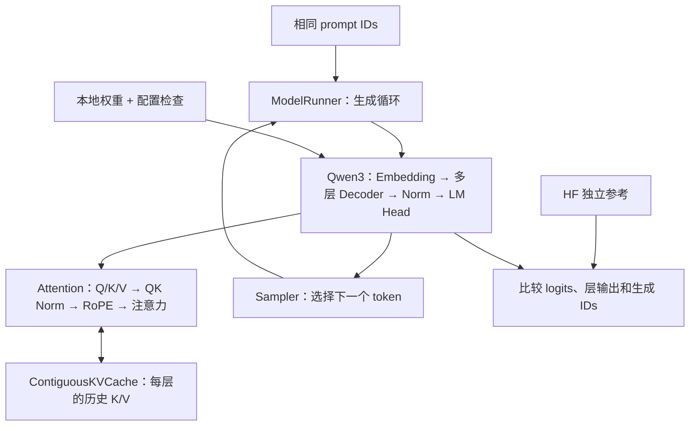

# M1 代码设计与原理：手写 Qwen3 前向与连续 KV Cache

> 状态：M1 代码已实现。本文承接 [M0 代码文档](M0代码设计与原理.md)，解释现有代码组织、模块职责和验证方法。环境与实际运行命令见 [M1 运行与学习指南](M1运行与学习指南.md)；第 7 节仍使用流程伪代码帮助理解，不是独立可运行程序。

验证结果与排错证据见 [M1 实验记录](experiments/m1-310b4/README.md)：27 项测试、CPU 完整权重控制组，以及 310B4 FP16 的短输入逐层与生成对拍。结果只覆盖已记录的案例，不代表任意长度和后端配置均已验证。

阅读顺序：先看第 1～4 节理解整体数据流，再看缓存与生成循环，最后按测试顺序实现。环境进入、退出以及 M1 命令见 [M1 运行与学习指南](M1运行与学习指南.md)。

## 1. M1 要解决什么问题

M0 通过 HF 的 `model.generate()` 完成推理，模型层计算、缓存更新和生成循环由 HF 管理。M1 要把这些关键路径写成能够逐行跟踪的代码：给定同一组权重和 token IDs，自己的前向结果能否与参考实现一致？加入 KV Cache 后，是否仍与每次重算整个前缀一致？

第一版范围固定为：Qwen3-0.6B、单请求、无 padding、eager attention、连续 KV、greedy 解码。CPU FP32 小模型负责定位数学与状态错误，310B4 FP16 负责验证实际设备路径。随机采样、分页缓存、连续批处理、服务和融合算子留到后续阶段。

这里的“手写”指自己组织 PyTorch 张量运算和状态管理，底层矩阵乘法仍调用框架算子。HF 可以提供 tokenizer 和独立参考结果，但自研路径不能转调 HF 的模型 `forward()` 或 `generate()` 来完成计算。

M1 验收以实现、测试和原始报告为准。本文解释代码，不把设计目标或未测量的速度写成简历成果。

## 2. 文件怎样分工

以下文件均已实现，按模型计算、缓存状态、请求循环和验证工具分工。

| 文件 | 实现内容 | 输入与输出 |
| --- | --- | --- |
| `mini_llm_ascend/engine/model.py` | 配置检查、RMSNorm、RoPE、Attention、MLP、DecoderLayer、Qwen3 模型 | IDs、缓存 → logits |
| `mini_llm_ascend/engine/weights.py` | 本地 safetensors 权重加载与严格检查 | 模型目录 → 已装载参数的模型 |
| `mini_llm_ascend/cache/contiguous_kv.py` | 预分配连续缓存、分层写入、有效长度与重置 | 本层 K/V → 当前可见 K/V |
| `mini_llm_ascend/engine/sampler.py` | 贪心选择与 EOS 约束 | 最后位置 logits → 下一个 ID |
| `mini_llm_ascend/engine/model_runner.py` | 单请求 prefill/decode 循环、请求级缓存生命周期 | prompt IDs、生成配置 → 输出 IDs |
| `bench/compare_m1.py` | HF 与自研路径对拍，保存误差和首个分歧位置 | 相同模型、相同输入 → 正确性报告 |
| `bench/m1.py`、`bench/m1_common.py` | 自研生成入口、模型身份与误差统计工具 | 命令参数 → 文字与 JSON |
| `tests/test_model.py` | 数学组件、权重和小模型前向测试 | 随机小配置，不依赖真实大权重 |
| `tests/test_contiguous_kv.py` | 容量、写入位置、重置、异常状态测试 | 小尺寸缓存 |
| `tests/test_m1_generation.py` | 缓存/重算等价、逐 token 对拍、终止行为 | 固定短序列 |
| `tests/test_m1_compare.py` | 误差统计、NaN/shape 异常、失败报告保留 | 小张量与故障注入 |

包中已加入初始化文件。首版使用普通函数和少量 `nn.Module`，没有引入后端插件系统。`model.py` 初期可以集中阅读，确实变长后再拆分；不要为每个简单运算建立一层抽象。



## 3. 先统一张量语言

令 `B=1`，本次输入长度为 `Q`，此前已缓存长度为 `P`，本次可见总长度为 `T=P+Q`，缓存容量为 `C`。Prefill 通常 `P=0, Q=S`；逐 token decode 为 `Q=1`。

Qwen3-0.6B 的关键配置为 28 层、hidden size 1024、16 个 Q head、8 个 KV head、head dimension 128、MLP 宽度 3072、词表 151936。配置开启 embedding 权重共享，使用默认 RoPE，未开启滑动窗口。实现必须读取并校验本地配置；这些数字用于讲解，不能代替配置解析。[官方配置](https://huggingface.co/Qwen/Qwen3-0.6B/blob/main/config.json)

| 张量 | 逻辑 shape | 解释 |
| --- | --- | --- |
| `input_ids` | `[1, Q]` | 本次实际输入的 token |
| `hidden_states` | `[1, Q, 1024]` | 每个 token 的隐藏向量 |
| Q 投影后 | `[1, Q, 2048]` | `16 × 128`，不是 hidden size |
| Q 分头后 | `[1, 16, Q, 128]` | 注意力计算布局 |
| 当前 K/V | 各 `[1, 8, Q, 128]` | KV head 少于 Q head |
| 可见 K/V | 各 `[1, 8, T, 128]` | 只包含有效前缀 |
| 注意力分数 | `[1, 16, Q, T]` | 每个 query 对可见 key 的分数 |
| 最后位置 logits | `[1, 1, 151936]` | 用于生成下一个 token |

最容易写错的是用 `hidden_size / num_attention_heads` 推出 64。此模型显式设置 `head_dim=128`，Q 的总宽度是 2048，最后通过输出投影回到 1024。

## 4. 一次模型前向内部发生什么

本节的计算顺序对照固定版本 [Transformers 4.51.3 Qwen3 实现](https://github.com/huggingface/transformers/blob/v4.51.3/src/transformers/models/qwen3/modeling_qwen3.py)。实现时保持精度转换和运算顺序一致，优化路径另行验证。

### 4.1 配置与 Embedding

加载前验证 `model_type`、head 数整除关系、偶数 head dimension、激活函数、bias、RoPE 和滑动窗口配置。首版不支持的配置应直接报错，不能悄悄按当前模型的假设计算。

Embedding 把整数 ID 当作权重矩阵的行号：`[1,Q] → [1,Q,H]`。它是查表，不是对 ID 数值做线性缩放。进入模型前验证 batch 为 1、输入非空、ID 在词表内、输入和参数设备一致。

### 4.2 RMSNorm：控制向量尺度

对最后一个维度为 D 的向量，计算：

```text
rms_norm(x) = x / sqrt(mean(x²) + eps) × weight
```

它不减均值，因此不能用普通 LayerNorm 替换。实现先转 FP32 求平方均值及归一化，再按参考顺序转回输入 dtype、乘缩放权重，避免 FP16 平方累积造成不必要的误差。

三种位置使用相同的数学操作：层输入归一化、MLP 前归一化，以及 Q/K 每个 head 的归一化；前两者 D=1024，最后一种 D=128。最终输出还有一次模型级 RMSNorm。

### 4.3 Q/K/V 投影与 QK Norm

以 PyTorch 的线性层约定，权重 shape 为 `[out_features,in_features]`，实际计算是 `x @ weight.T`。

```text
x_norm → q_proj → reshape 成多个 head → q_norm
       → k_proj → reshape 成多个 head → k_norm
       → v_proj → reshape 成多个 head
```

Q/K Norm 分别作用于每个 head 的最后 128 维，不能跨 head 求均值，V 不做这一步。随后转换为 `[B,heads,Q,D]` 布局。

### 4.4 RoPE：把绝对位置编码进 Q 和 K

位置必须从缓存长度继续：本次 position IDs 是 `[P,P+1,...,P+Q-1]`，decode 不能每次都从 0 开始。默认 RoPE 用位置与频率生成 cos/sin，再旋转 Q 和 K；V 保持原值。

采用参考实现的前半/后半维度配对方式：若向量写作 `[a,b]`，旋转分量为 `[-b,a]`，不是相邻两个维度互换。频率在 CPU 以 FP32 初始化，再搬到目标设备，通过 batched matmul 与位置组合；三角函数用 FP32 后转换到计算 dtype。该顺序与固定版本 HF 对齐，避免把代数等价误认为后端运算结果必然相同。首版不实现动态 RoPE scaling，配置要求明确匹配。

缓存存放**已做 QK Norm 和 RoPE 的 K，以及投影后的 V**。以后再次使用历史 K 时不重复旋转，否则位置作用会叠加。

### 4.5 GQA、因果 mask 和 Attention

16 个 Q head 共享 8 个 KV head，分组比例为 2。参考路径将每个 KV head 沿 head 维重复两次，使其能与 Q 相乘；永久缓存仍只保存 8 个 KV head，避免把共享收益抵消。

```text
scores = Q @ Kᵀ / sqrt(head_dim)
scores = scores + causal_mask
probabilities = softmax(scores，沿 key 维)
context = probabilities @ V
```

Softmax 使用 FP32 累积后转回计算 dtype。输出从 `[1,16,Q,128]` 转回 `[1,Q,2048]`，再经 `o_proj` 得到 `[1,Q,1024]`。转置后的内存可能不连续，不能无条件直接 `view()`；应清楚区分逻辑维度变化和实际拷贝。

因果规则为：**query 的局部下标 i 只能访问 key 下标 j ≤ P+i**。以下是 P=3、Q=2 的例子，1 表示可见：

```text
              key 0  1  2  3  4
query pos 3       1  1  1  1  0
query pos 4       1  1  1  1  1
```

若直接给 `[Q,T]` 做无偏移的左上三角 mask，会把历史前缀错误遮住。实际加法 mask 的允许位置为 0，禁止位置使用与参考路径一致的极小值。只读取 `:T` 有效缓存，不让未初始化容量进入 softmax。单 token decode 对整个有效前缀均可见。

### 4.6 残差与 MLP

一层 Decoder 的顺序是：

```text
a = x + Attention(RMSNorm(x))
y = a + MLP(RMSNorm(a))
MLP(z) = down_proj(silu(gate_proj(z)) × up_proj(z))
```

残差保留未归一化的分支；不能把 `x` 覆盖成 norm 输出后再相加。MLP 中的乘法是逐元素乘，不是矩阵乘：两条 `[1,Q,3072]` 分支组合后，投影回 `[1,Q,1024]`。

### 4.7 Final Norm 与 LM Head

经过全部层后执行最终 RMSNorm，再投影到词表。生成时只对最后位置做词表投影，减少 `[Q,vocab_size]` 的临时结果；逐位置正确性测试则显式开启全位置 logits。

`tie_word_embeddings=true` 表示输入查表与输出投影共享同一参数。加载器要处理 checkpoint 只保存一份或保存两份的情形：两份存在时核对是否一致；不一致则报出模型身份/权重问题，不能任意丢弃一份。

## 5. 连续 KV Cache：状态比数组本身更重要

### 5.1 数据布局与容量

实现为每层分配一对 `[1,Hkv,C,D]` 的 K/V 张量，保存到长度为 L 的列表中。每个张量连续分配，层之间不要求共用一个大张量。

FP16 的逻辑 KV 存储为：

```text
每 token = 2(K/V) × 28层 × 8头 × 128维 × 2字节
         = 114688 字节 = 112 KiB
C=512    → 56 MiB
C=2048   → 224 MiB
```

这是缓存张量的逻辑字节数，不包含模型参数、allocator 预留、重复 KV 的临时张量和注意力分数。预分配后减少每步扩容与历史复制，但整段容量一开始就占用，短请求也会留下未用槽位。

### 5.2 实际接口与不变量

| 接口/状态 | 责任 |
| --- | --- |
| `length` | 已完成整次模型前向、对所有层都有效的 token 数 |
| `begin_step(q_len)` | 检查容量和状态，记录固定的 `start=length`、`end=start+q_len` |
| `write_layer(layer_idx,k,v)` | 检查 shape、dtype、设备和层号，只写本层 `[start:end]` |
| `view_layer(layer_idx)` | 本层写入后返回 `:end`，包含当前 K/V |
| `commit_step()` | 确认所有层都成功写入，再一次性把 `length` 更新为 end |
| `abort_step()` | 标记本次失败，禁止把半写入状态当作完整前缀继续生成 |
| `reset()` | 清空逻辑长度、事务状态；下一请求重新覆盖有效区 |

缓存的核心不变量是：所有层共享同一个已提交长度，每层每步恰好写一次，只有有效范围可以被读取。请求运行器负责保证一次只推进一个请求；M1 的缓存不能被并发请求共享。

**不能在每层写完后都执行 `length += Q`**，否则第 2 层会写到错误位置，28 层之后长度也会膨胀 28 倍。应在整个模型前向及所需输出计算成功后统一提交。

采用异常后重置/丢弃缓存的简单策略；暂不承诺在半次前向失败后原地恢复。`reset()` 不一定需要将全部张量清零，但必须保证旧数据不会通过有效区或 mask 泄漏到新请求。

### 5.3 为什么先写 KV，再做注意力

本层当前 token 的 K/V 也必须参与本层注意力，所以顺序是：

```text
生成当前 Q/K/V → QK Norm → RoPE
→ 写入本层当前 K/V → 取历史 + 当前 K/V
→ 注意力 → 输出投影 → 后续层
```

写入发生在层内，提交总长度发生在整次前向成功后，两者不是同一件事。若等采样后才写当前 K/V，注意力会漏看当前位置。

## 6. 权重加载怎样避免“能运行但算错”

`weights.py` 先解析本地 `config.json` 和 safetensors 的键名/shape，再按目标 dtype/device 安装参数；模型目录不触发在线下载或远程代码。首版限定单文件 checkpoint，遇到分片索引会明确拒绝。通过 meta device 先创建模型结构，再在 CPU 分配目标 dtype 的空参数，按张量加载；这样不用先生成一份完整随机权重。`to_empty()` 和设备迁移后显式恢复 embedding/lm_head 共享绑定。

| checkpoint 项目 | 应检查的内容 |
| --- | --- |
| `model.embed_tokens.weight` | `[vocab_size,H]` |
| `model.layers.i.self_attn.q_proj.weight` | `[Hq×D,H]` |
| `model.layers.i.self_attn.k_proj.weight` / `v_proj.weight` | `[Hkv×D,H]` |
| `model.layers.i.self_attn.o_proj.weight` | `[H,Hq×D]` |
| `model.layers.i.self_attn.q_norm.weight` / `k_norm.weight` | `[D]` |
| 两个层级 norm、三个 MLP 投影 | 与配置中的 H、I 匹配 |
| `model.norm.weight`、可选 `lm_head.weight` | 最终归一化与共享权重规则 |

检查遗漏键、意外键、层数、shape 和非有限值，允许项必须明确列出。不能依靠 `strict=False` 隐藏漏载参数。测试还要验证 lm_head 与 embedding 确实共享参数存储，而不只是初始化时数值相同。

M0 权重文件的历史校验值见[实验记录](experiments/m0-310b4/README.md)。M1 报告需要重新记录所用本地文件哈希、配置及代码身份；未知的上游 revision 应继续标注未知。

## 7. ModelRunner：把一次前向变成生成过程

下面是流程伪代码，**不是可以直接复制执行的接口**：

```text
validate(prompt_ids, output_budget, cache_capacity)
cache.reset()
try:
    logits = model.forward(prompt_ids, cache)       # prefill
    for output_index in range(output_budget):
        token = greedy_select(logits, eos_policy)
        output_ids.append(token)
        if reached_eos or output_budget_exhausted:
            break
        logits = model.forward([[token]], cache)   # decode
finally:
    cache.reset()                                 # 请求结束或失败均回收状态
```

模型内部包住缓存的 begin/commit/abort；运行器包住请求的开始与结束。两层异常处理分别保护“这次 forward”与“整个请求”。推理用 `eval()` 和 `inference_mode()`，避免训练态行为及梯度开销。

### 7.1 Prefill 与 Decode 交界的例子

| 操作 | 本次输入 | 前向后 KV 长度 | 采样得到 |
| --- | --- | --- | --- |
| Prefill | `[101,102,103]` | 3 | 201 |
| Decode 1 | `[201]` | 4 | 202 |
| Decode 2 | `[202]` | 5 | 203，输出预算到达 |

这些 ID 仅用于示意。最终输出 3 个 token，但缓存只有 prompt 加前 2 个输出 token 的 K/V；203 没有再次输入模型，因此没有它的 K/V。生成 N 个 token 通常需要一次 prefill 和 N−1 次 decode。

容量检查可以保守要求 `prompt_length + max_new_tokens <= capacity`，同时不超过本地配置的位置上限；虽然最后一个输出可能无需进入缓存，这样的预算规则更直观。实际写入还必须独立检查，不能只信任入口检查。

### 7.2 Greedy、EOS 与固定长度

`sampler.py` 首版只负责最后位置的 argmax，先验证 logits 有限。EOS 可以是一个 ID 或一组 ID，应统一为集合处理。

普通生成遇 EOS 或达到输出预算结束。固定长度实验若要对齐 M0 的 `min_new_tokens=max_new_tokens`，必须在选择 token **之前屏蔽 EOS**；选择到 EOS 后仅仅忽略停止信号不是同一种生成策略。两边应使用完全相同的约束与允许 token 集合。

首版不引入 temperature、top-p、随机采样。greedy 方便对拍，但两端小的浮点差异仍可能改变相近 logits 的排序，不能保证不同设备输出永远相同。

## 8. 怎样证明结果正确

### 8.1 分层验证，而不是只看生成文本

1. **组件**：RMSNorm、RoPE、GQA 和 causal mask 使用小张量，分别与参考或手算结果核对。
2. **单层**：相同参数和输入下，比较 attention 输出、MLP 输出与层输出，定位第一处偏差。
3. **小模型**：CPU FP32、固定种子、随机小权重，与 HF 完整前向比较。配置特意令 `Hq×D != H`，防止错误实现只在标准维度上碰巧通过。
4. **缓存等价**：本次 decode 的 logits 对比“同一完整前缀、不使用缓存、重新前向”的最后位置 logits。
5. **真实权重**：先短 prompt，逐步扩大长度；在 NPU FP16 上记录层输出、最终 logits 和 greedy IDs。

调试中间张量会引入拷贝、同步和存储开销，应作为显式调试模式，不与性能测量混跑。

### 8.2 Teacher forcing 与自由生成要分开

Teacher forcing 是给 HF 和自研路径喂入**完全相同的后续 token 序列**，逐步比较 logits。该序列可预先固定或由参考模型生成并保存。

若两边各自生成，第 2 步选择不同 token，第 3 步输入就已经不同；此后 logits 不一致不能直接归因于该步数学错误。因此先做固定输入对拍，再做各自 greedy 的端到端比较，并保存首次分歧的步数、输入前缀和候选排名。

### 8.3 误差报告应该包含什么

令参考值为 r，自研值为 a，以 FP32 统计：

```text
absolute_error = |a-r|
relative_error = |a-r| / max(|r|, epsilon)
通过条件示例：每个元素 |a-r| <= atol + rtol×|r|
```

至少记录最大/平均绝对误差、相对误差统计、非有限值、最差位置、逐位置 top-1 一致率，以及分歧位置参考 top-1/top-2 的分数差。近零参考值会放大相对误差，因此不能只用这一项判定。

CPU FP32 小模型可从 `atol=1e-5, rtol=1e-4` 作为待验证起点；NPU FP16 阈值需结合相同权重转换及参考后端误差校准。原始设计的单一 `max_abs < 1e-2` 不应被当作对所有长度和中间层都合理的结论。验收阈值、校准样本和保留测试集要事先记录；失败后不能默默放宽阈值。

无论阈值如何，NaN/Inf、缓存越界、位置错误或串请求都必须判失败。CPU 通过不能代替 NPU 验收，生成文本通顺也不能代替数值对拍。

### 8.4 已实现的必要测试

| 测试 | 要抓住的错误 |
| --- | --- |
| Q head 总宽度不同于 hidden size | 错用 `H/Hq` 当作 head dimension |
| RoPE 非零起始位置 | decode 每轮位置归零、重复旋转历史 K |
| 历史长度 P>0、输入 Q>1 的 mask | 因果遮罩缺少历史偏移 |
| 多层缓存写入 | 每层重复增长总长度、跨层写错位置 |
| 恰好容量与超过容量 | 最后合法槽位错判、越界后才报错 |
| reset 后换输入 | 旧长度或旧 KV 污染新请求 |
| 中途某层异常 | 半写入状态被继续复用 |
| 连续 decode 与无缓存重算 | KV 写入时机、位置、前缀读取错误 |
| 缺失/多余/错形状权重、共享参数 | 静默漏载和重复占用 |
| 仅生成 1 token、提前 EOS、固定长度 | 多跑一步、漏首 token、EOS 语义不一致 |
| 固定后续 token 的多步 HF 对拍 | 首次分歧之后比较不同输入 |

## 9. 板端实施与运行说明

当前可直接执行的环境进入方式保持不变：

```bash
cd /root/mini-llm-ascend
source /usr/local/Ascend/ascend-toolkit/set_env.sh
source .venv/bin/activate
```

用 `command -v python` 核对路径为 `/root/mini-llm-ascend/.venv/bin/python`。现有环境探测和 M0 测试可按[运行指南](M0环境与基线.md)执行；它们通过只能说明已有路径正常。

实际入口为 `python -m bench.m1`（自研生成）和 `python -m bench.compare_m1`（HF 对拍），均要求传入 `--model`。完整可复制命令、报告查看与失败判定见 [M1 运行指南](M1运行与学习指南.md)。

本阶段按以下顺序实现；学习时也可按这个顺序阅读和运行：

1. 配置、RMSNorm、RoPE、Attention、MLP，先完成 CPU 小模型无缓存前向。
2. 权重映射与 HF 小模型对拍，确认层计算正确。
3. 连续 KV、带历史偏移的 mask、逐 token 与无缓存重算对拍。
4. 生成循环和 EOS 测试。
5. 真实 Qwen3 权重的短输入验证，随后验证 NPU FP16。
6. 保存正确性报告和限制，再考虑与 M0 公平计时。

板上共享内存有限，HF 与自研完整模型不必同时驻留。可以分进程生成相同输入下的参考结果，再加载自研模型对拍；参考文件要包含模型哈希、输入 IDs、dtype、软件版本和必要中间结果，避免拿不同条件的文件比较。首次新 shape 的算子编译可能耗时，沿用 M0 的阶段日志和显式同步方式观察进度。

停止前台运行使用 `Ctrl+C`，等待进程退出后再 `deactivate`。退出虚拟环境不会停止仍在运行的后台程序，也不会撤销当前 shell 已加载的 CANN 环境；关闭 SSH 会话使用 `exit`。

## 10. 报告、性能与后续衔接

正确性报告保存：状态、失败原因、代码 commit 和 dirty 状态、模型哈希、依赖/设备信息、输入 IDs、执行 dtype、参考配置、缓存容量、测试案例、阈值、逐步误差及首次分歧。报告初始 `passed=false`，未完成阶段没有成功结论；`stage` 标明最近开始的阶段。失败/中断时保留已完成的 cases，只有全部比较及自由生成通过才返回成功。

性能实验另行运行。若复用 M0 的 TTFT/TPOT 口径，需要对齐 tokenizer、thinking、输入输出 IDs/长度、EOS、预热、缓存策略及计时边界；NPU 异步操作必须在相应边界同步。把调试拷贝或模型加载算入其中一边，会使比较失去意义。手写前向本身不保证快于 HF。

M1 的连续缓存将成为 M2 的正确性参考：先固定模型数学和生成行为，再替换 KV 存储/索引方式。M2 即使加入分页，也需要证明在同样输入下与 M1 结果一致，随后再测内存和速度。

## 11. 四个学习练习

1. 对 prompt 长度 4、输出长度 3，列出每次 forward 的输入、position IDs 和缓存长度，解释最后输出 token 为什么可能不在缓存中。
2. 手画 P=2、Q=3 时的 `[3,5]` 可见矩阵，验证每行可以看到哪些 key。
3. 对比 `K/V` 保存 8 个 head 与错误保存 16 个 head 时的缓存容量，说明 GQA 的节省发生在哪里。
4. 假设第 7 层报错，解释此前写入的层为什么不能被当作完整请求继续使用，以及 reset 后为什么只允许读取新的有效区。

读完后应能解释三个设计选择：位置为什么跟随已提交缓存长度、缓存为什么在层内写入而在模型级提交、正确性为什么先比较相同输入再比较自由生成。

## 12. 对照实际代码逐函数阅读

### 12.1 模型计算文件

[model.py](../mini_llm_ascend/engine/model.py) 内的 `ModelConfig` 是不可变 dataclass，只保留实际参与计算的配置。`from_dict()` 拒绝不支持的模型变体，`__post_init__()` 检查维度、整除关系和数值范围。它不继承 HF 配置类，因此模型数学不会隐式依赖 HF forward。

`RMSNorm.forward()` 完成最后一维归一化；`rotary_factors()` 根据本次绝对位置生成 cos/sin；`apply_rope()` 实际旋转 Q/K；`causal_mask()` 根据历史长度生成带偏移的因果遮罩。把这些函数单独列出，是为了能用很小的手算例子测试。

`Attention.forward()` 按第 4 节顺序执行投影、QK Norm、RoPE、缓存写入、GQA 和注意力；`MLP.forward()` 实现门控前馈；`DecoderLayer.forward()` 保留两个残差分支。`ModelBody` 只组织 embedding、layers、norm 的参数名称，让权重键与 checkpoint 对齐。

`Qwen3.new_cache()` 从模型的实际 device/dtype 创建缓存。`Qwen3.forward(input_ids, cache=None, last_only=True, trace=None)` 是完整入口：检查输入，开始缓存步骤，计算所有层和 logits，最后提交缓存。如果中途失败，调用 `abort_step()` 再抛出原异常。无缓存时直接以位置 0 开始计算整个输入，便于作为“重算前缀”参考。

`last_only=False` 只增加词表投影的输出位置，不改变 Transformer 层的计算。`trace(name,tensor)` 在 embedding、每层和 final norm 后执行；模型本身不拷贝张量，调用者决定是否保存。对拍回调会立即复制到 CPU，避免引用后续变更的内存。

### 12.2 缓存与请求循环

[contiguous_kv.py](../mini_llm_ascend/cache/contiguous_kv.py) 中 `_step=(start,end)` 固定本次各层的写入区间，`_written` 记录已完成的层，`_failed` 阻止异常后的继续复用。`length` 只表示已提交长度；本层注意力读取当前步骤的 `end`，因此既能看历史，也能看当前 token。

`reset()` 清空逻辑状态，不释放容量张量；`nbytes` 统计实际缓存张量的元素数乘字节数。[model_runner.py](../mini_llm_ascend/engine/model_runner.py) 的 `ModelRunner` 持有模型及一份缓存，`generate()` 开始时 reset、结束或异常时在 finally 中 reset。同一个 runner 可顺序处理多个请求，但不支持并发调用，也不跨请求复用前缀。

[sampler.py](../mini_llm_ascend/engine/sampler.py) 的 `normalize_eos()` 统一单个/多个 EOS 并验证范围；`greedy_select()` 检查 logits 有限，必要时屏蔽 EOS，然后 argmax 并把一个 ID 传回 host。`on_token` 回调发生在 host 已拿到 token 后，可用于观察时间或交互；回调异常也会触发请求缓存重置。

### 12.3 权重装载与报告工具

[weights.py](../mini_llm_ascend/engine/weights.py) 的 `load_model()` 使用 meta device 建结构、`to_empty()` 分配 CPU 参数、检查文件键和 shape、核对共享参数、逐张量转换并检查有限性，最后搬到目标设备。它不会训练模型，也不会在线下载缺失文件。

[m1_common.py](../bench/m1_common.py) 中 `file_sha256()` 分块读取大文件，避免一次把整份权重读入 Python 内存；`provenance()` 记录模型文件和源码指纹；`prepare_input()` 保持与 M0 相同的无 thinking 聊天模板，并从本地 generation config 读取 EOS。

`compare_tensors()` 将数据变成 CPU FP32，先检查 shape 和有限性，再计算误差阈值、最大/平均误差和超标元素数。logits 额外统计 top-1 一致率；近似数值通过与生成 ID 一致是分别报告的指标。

[probe_m1_rope.py](../bench/probe_m1_rope.py) 是不加载权重的 NPU 回归探针，覆盖实际 head_dim=128、Prefill 和若干非零 decode 位置。它还保留旧的“设备上初始化频率 + 逐元素乘法”作为诊断对照；旧写法不参与模型计算。位置 21 的小张量已观察到旧路径 cos 相差 `3.814697265625e-06`，说明仅靠 CPU 小模型通过不足以确认目标设备数值行为。

[compare_m1.py](../bench/compare_m1.py) 的 `capture_hf()` 给 HF 注册临时 hook，使用确定的后续 token 收集参考，并在 finally 中移除 hook。它另外测量 HF 自己的缓存/重算误差，控制组也必须满足阈值。`compare()` 先运行 HF，再释放大模型、加载自研模型，逐步比较层输出、logits 和缓存重算结果，最后进行独立生成。`parse_args()` 固定并记录阈值；`main()` 将失败、中断和未完成状态保留为 JSON，并返回相应退出码。

[m1.py](../bench/m1.py) 的 `main()` 提供单请求启动和短请求基准入口：准备输入、加载自研模型，按 `--warmup` 运行不参与统计的完整请求，再按 `--runs` 记录正式样本。`run_once()` 在设备同步后计时，观察 host token 时间，结束同步后复用 M0 的指标公式。模型加载、分词、输入传输、KV 容量分配和文本解码位于计时区间外。预热和正式请求都重置逻辑缓存，没有前缀复用。

多轮报告用 `warmup_runs/runs/summary` 区分预热、原始样本与统计结果，摘要给出均值、中位数和范围。默认仍为不预热、运行一次；这种情况下额外保留原有顶层 `metrics/output_ids/text` 字段。短样本报告不能代替长上下文或持续负载实验。

代码保留了输入 ID 范围检查、logits 有限性检查和 host 取样，这些操作可能引入设备同步；教学版先保证状态与错误可解释，性能优化需要后续 profiling 证据。
